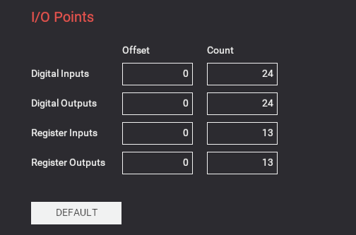
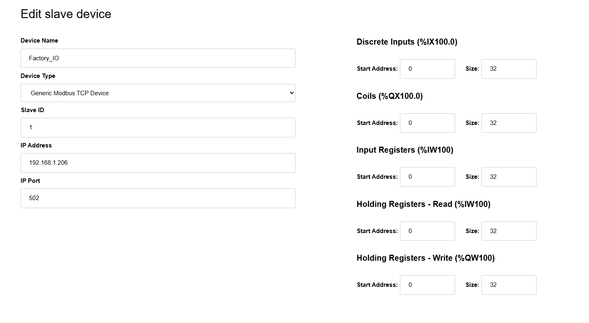
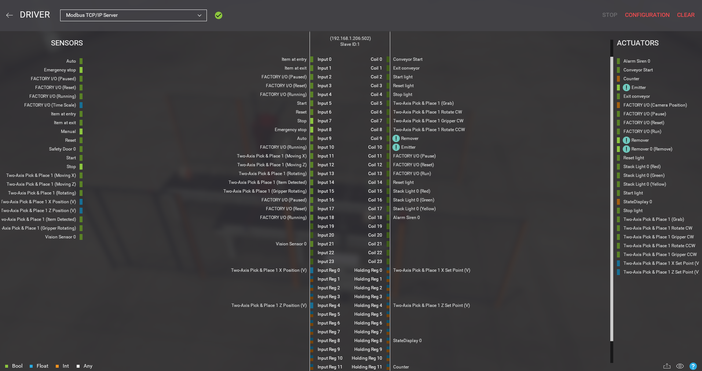

# Modbus/TCP mapping: Factory I/O ↔ OpenPLC

The quality-control cell uses Modbus/TCP in a client–server topology:

- **Factory I/O** runs the *Modbus TCP/IP Server* driver (port **502**, Slave ID **1**).
- **OpenPLC** acts as the **client**. It runs either on the PC (step 1) or on
  the Raspberry Pi (step 2), and the configuration is identical in both cases.

I/O points are allocated in **contiguous blocks starting at offset 0**. Each
scan therefore needs only one multi-bit or multi-register transaction per
Modbus table. Analog values travel as **scaled 16-bit integers (scale factor
100)**, which avoids any 32-bit float byte-order ambiguity.

## Server side (Factory I/O)

| Setting | Value |
| --- | --- |
| Driver | Modbus TCP/IP Server |
| Host / port | IP of the PC running Factory I/O (`192.168.1.206` in our test LAN), port `502` |
| Network adapter | bound explicitly to the wired interface |
| Slave ID | `1` |
| I/O points (offset / count) | Digital Inputs 0 / 24, Digital Outputs 0 / 24, Register Inputs 0 / 13, Register Outputs 0 / 13 |

## Client side (OpenPLC Runtime → *Slave Devices* → *Add device*)

| Field | Value |
| --- | --- |
| Device name | `Factory_IO` |
| Device type | Generic Modbus TCP Device |
| Slave ID | `1` |
| IP address / port | IP of the Factory I/O PC, `502` |
| Discrete Inputs (`%IX100.0`) | start 0, size 32 |
| Coils (`%QX100.0`) | start 0, size 32 |
| Input Registers (`%IW100`) | start 0, size 32 |
| Holding Registers – Read | start 0, size 32 |
| Holding Registers – Write (`%QW100`) | start 0, size 32 |

OpenPLC packs bits 8 per byte. Bit *n* of a Modbus table therefore maps to
`%IX(100 + n/8).(n mod 8)`, and the same rule applies to `%QX`.

## Signal table

The Factory I/O tag-to-table assignment comes from the driver view below. The
last column gives the variable of `openplc/qc_cell_factoryio/pous/programs/main.st`
that each signal corresponds to.

### Sensors → PLC (Factory I/O *Inputs* → OpenPLC Discrete Inputs)

| Factory I/O tag | Modbus | OpenPLC | ST variable |
| --- | --- | --- | --- |
| Item at entry | Input 0 | `%IX100.0` | `ItemAtEntry` |
| Item at exit | Input 1 | `%IX100.1` | `ItemAtExit` |
| FACTORY I/O (Paused) | Input 2 | `%IX100.2` | — |
| FACTORY I/O (Reset) | Input 3 | `%IX100.3` | — |
| FACTORY I/O (Running) | Input 4 | `%IX100.4` | — |
| Start | Input 5 | `%IX100.5` | `StartBtn` |
| Reset | Input 6 | `%IX100.6` | `ResetBtn` |
| Stop | Input 7 | `%IX100.7` | `StopBtn` |
| Emergency stop | Input 8 | `%IX101.0` | `Estop` |
| Auto | Input 9 | `%IX101.1` | `AutoSel` |
| FACTORY I/O (Running) | Input 10 | `%IX101.2` | — |
| Two-Axis Pick & Place 1 (Moving X) | Input 11 | `%IX101.3` | `PP_MovingX` |
| Two-Axis Pick & Place 1 (Moving Z) | Input 12 | `%IX101.4` | `PP_MovingZ` |
| Two-Axis Pick & Place 1 (Rotating) | Input 13 | `%IX101.5` | — |
| Two-Axis Pick & Place 1 (Item Detected) | Input 14 | `%IX101.6` | `PP_ItemDet` |
| Two-Axis Pick & Place 1 (Gripper Rotating) | Input 15 | `%IX101.7` | — |
| FACTORY I/O (Paused) | Input 16 | `%IX102.0` | — |
| FACTORY I/O (Reset) | Input 17 | `%IX102.1` | — |
| FACTORY I/O (Running) | Input 18 | `%IX102.2` | — |
| Vision Sensor 0 | Input 21 | `%IX102.5` | `VisionOK` |

### PLC → actuators (OpenPLC Coils → Factory I/O *Coils*)

| Factory I/O tag | Modbus | OpenPLC | ST variable |
| --- | --- | --- | --- |
| Conveyor Start (infeed) | Coil 0 | `%QX100.0` | `ConvEntry` |
| Exit conveyor | Coil 1 | `%QX100.1` | `ConvExit` |
| Start light | Coil 2 | `%QX100.2` | — |
| Reset light | Coil 3 | `%QX100.3` | — |
| Stop light | Coil 4 | `%QX100.4` | — |
| Two-Axis Pick & Place 1 (Grab) | Coil 5 | `%QX100.5` | `Grab` |
| Two-Axis Pick & Place 1 Rotate CW | Coil 6 | `%QX100.6` | `RotCW` |
| Two-Axis Pick & Place 1 Gripper CW | Coil 7 | `%QX100.7` | `GripCW` |
| Two-Axis Pick & Place 1 Rotate CCW | Coil 8 | `%QX101.0` | `RotCCW` |
| Remover | Coil 9 | `%QX101.1` | — |
| Emitter | Coil 10 | `%QX101.2` | — |
| FACTORY I/O (Pause) | Coil 11 | `%QX101.3` | — |
| FACTORY I/O (Reset) | Coil 12 | `%QX101.4` | — |
| FACTORY I/O (Run) | Coil 13 | `%QX101.5` | — |
| Reset light | Coil 14 | `%QX101.6` | — |
| Stack Light 0 (Red) | Coil 15 | `%QX101.7` | `L_Red` |
| Stack Light 0 (Green) | Coil 16 | `%QX102.0` | `L_Green` |
| Stack Light 0 (Yellow) | Coil 17 | `%QX102.1` | `L_Yellow` |
| Alarm Siren 0 | Coil 18 | `%QX102.2` | `Siren` |

### Analog signals (scaled integers)

| Direction | Factory I/O tag | Modbus | OpenPLC | ST variable |
| --- | --- | --- | --- | --- |
| Sim → PLC | Two-Axis Pick & Place 1 X Position (V) | Input Reg 0 | `%IW100` | — |
| Sim → PLC | Two-Axis Pick & Place 1 Z Position (V) | Input Reg 4 | `%IW104` | — |
| PLC → Sim | Two-Axis Pick & Place 1 X Set Point (V) | Holding Reg 0 | `%QW100` | X set-point (`X_SP`) |
| PLC → Sim | Two-Axis Pick & Place 1 Z Set Point (V) | Holding Reg 4 | `%QW104` | Z set-point (`Z_SP`) |
| PLC → Sim | StateDisplay 0 | Holding Reg 8 | `%QW108` | — |
| PLC → Sim | Counter | Holding Reg 11 | `%QW111` | — |

## Practical notes

- Choose the Modbus polling period as a multiple or submultiple of the PLC scan
  time (20 ms), e.g. `T_poll = k · T_scan`. This reduces incoherent sampling of
  fast edges.
- When the cell runs without the simulator, the runtime log will show repeated
  `Factory_IO disconnected / Connection refused` messages. They are expected and
  do not affect the compliance tests; disable the slave device to silence them.
