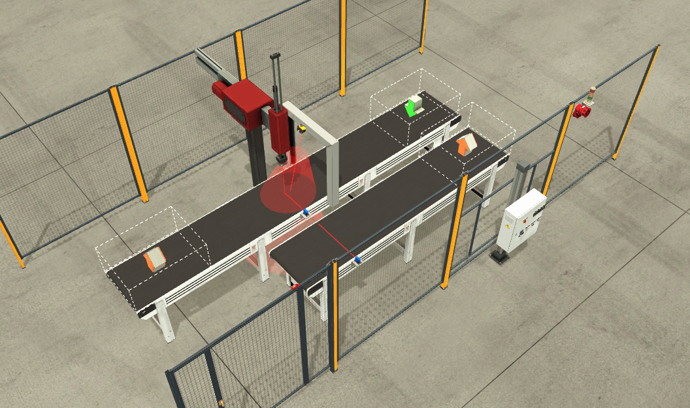

# Quality-control cell (virtual commissioning on Factory I/O)

This is the case study of paper Sec. V-B. Parts arrive on an infeed conveyor
and a vision sensor classifies them. A two-axis (X–Z) pick-and-place then
places conforming parts on the outfeed conveyor and sends the others back for
rework.

## Control logic

The program is [`pous/programs/main.st`](pous/programs/main.st): a finite-state
machine with safety gating.

| State | Name | What happens |
| --- | --- | --- |
| `0` | Idle / home | conveyors off, stop gate closed, P&P at safe position; yellow light while not running |
| `10` | Feeding | infeed conveyor runs until `ItemAtEntry` |
| `20` | Pick | Z down, `T_GRIP` delay, grab, `T_DWELL` dwell, Z up |
| `30` | Quality decision | `VisionOK` → `40`, otherwise → `60` |
| `40` | Place OK | X to `X_PLACE`, Z down, release, start exit conveyor |
| `60` | Rework | X to `X_REWORK`, Z down, release on the infeed conveyor |
| `80` | Cycle close | back to `X_PICK`, open/close stop gate, → `10` |
| `900` | Fault | red light + siren, all motion off; leaves only on `Reset` with permissives OK |

**Priorities.** Safety outranks reset, which outranks stop, which outranks
sequence progression:

- `Estop OR SafetyDoor` forces `State := 900` in every state.
- Start, stop, and reset act on rising edges (`R_TRIG`).
- Start is accepted only in `Auto` with `ConvPermit = NOT Estop AND NOT SafetyDoor`.

**Set-points.** Positions are percentages of axis travel:
`X_PICK = 35`, `X_PLACE = 75`, `X_REWORK = 15`, `Z_UP = 90`, `Z_DOWN = 12`.
Timings: `T_GRIP = 120 ms`, `T_DWELL = 200 ms`.

## Running it

1. **Factory I/O.** Build the scene shown above: infeed conveyor with stop
   gate, Two-Axis Pick & Place, vision sensor, exit conveyor, stack light,
   siren, and control panel with Start/Stop/Reset/E-Stop/Auto. Select the
   *Modbus TCP/IP Server* driver and configure it as described in
   [`docs/modbus_mapping.md`](../../docs/modbus_mapping.md).
2. **OpenPLC Runtime** (PC for step 1, Raspberry Pi for step 2). Add the slave
   device `Factory_IO` as described in the mapping document.
3. Open this folder in the OpenPLC Editor, compile, and upload to the runtime.
   The I/O variables are bound to the located addresses listed in the mapping
   document.
4. Start the runtime, put Factory I/O in *Run*, select **Auto**, and press **Start**.

The demo video shows the expected behavior: conforming parts go to the outfeed,
non-conforming parts recirculate, and E-Stop and the safety door stop all motion.
<https://doi.org/10.6084/m9.figshare.32680734>
