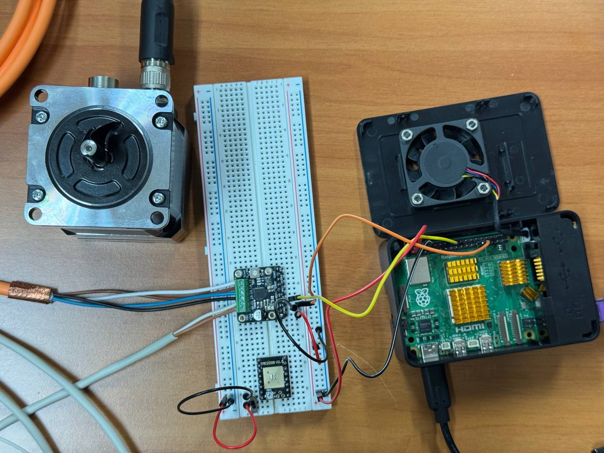

# SCARA base axis (A1): open-loop stepper control

This is the case study of paper Sec. V-C. The edge device drives the base axis
(A1) of a SCARA robot prototype through a TMC2209 stepper driver in classic
STEP/DIR/EN mode. A limit switch provides homing.



## Hardware and wiring (defaults in `a1_axis.py`)

| Signal | Raspberry Pi GPIO (BCM) | Notes |
| --- | --- | --- |
| STEP | 24 | high pulse 3 µs, minimum period 40 µs |
| DIR | 5 | `invert_dir=False` |
| EN | 6 | active-low |
| HOME | 23 | limit switch, active-low |

- The driver logic runs from the Pi. The motor supply is separate (12 V or 24 V,
  depending on the motor).
- **The Pi and the driver must share a common GND.**
- Set the driver's microstepping to **1/16** so that it matches
  `Mechanics.microsteps`.
- GPIO is accessed through the Linux GPIO character device (`lgpio`,
  `gpiochip=0`). If your kernel exposes the 40-pin header on another chip,
  change `gpiochip`.

## Mechanics and conversion

200 full steps/rev × 1/16 microstepping × 110:20 belt reduction (5.5) gives
**17 600 microsteps per output revolution**, or about **48.89 microsteps/deg**.
`deg_to_steps()` and `steps_to_deg()` derive these values from the
`Mechanics` dataclass, so any change to the pulleys or microstepping carries
through automatically.

## API

```python
from a1_axis import A1Axis

with A1Axis() as a1:            # open() / close() of the gpiochip
    print(a1.info())
    a1.enable()                 # EN active-low
    a1.home(direction=-1)       # seek, back off, slow latch, set position = 0°
    a1.move_to_deg(90.0)        # absolute move, trapezoidal/triangular ramp
    a1.move_by_deg(-30.0)       # relative move
    a1.disable()
```

`stop()` requests a software stop from another thread. The move in progress
then raises `AxisError`.

| Parameter | Default |
| --- | --- |
| Soft limits | ±145° (checked on the target and continuously during motion → `SoftLimitError`) |
| Max speed / acceleration | 120 °/s, 480 °/s² |
| Homing | seek 25 °/s, latch 5 °/s, back-off 5°, safety travel 350° |
| Moves before homing | refused (`require_homed_for_moves=True`) |

## Timing

Linux user space is not real-time. Pulses are timed with `time.sleep()` for the
bulk of each interval, followed by a short busy-wait. This works for moderate
speeds and bench testing. Higher step rates or tight multi-axis
synchronization call for DMA-based waveforms or a dedicated microcontroller
(see paper Sec. VI).

## Safety

`stop()` and the soft limits are software protections. They do **not** replace
a hardware emergency stop. Keep the robot's working area clear: running
`python3 a1_axis.py` homes the axis immediately and then moves it to +90°, −90°,
and 0°.
